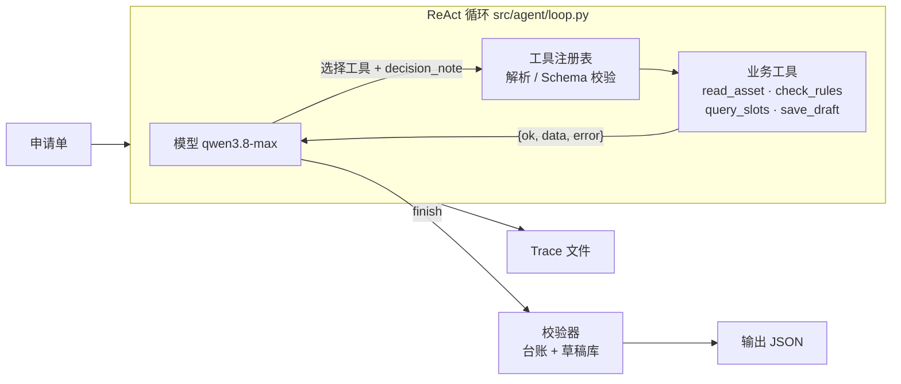

# 02 方案：调用流程、动态决策与技术取舍

核心原则：**模型做决策，代码守边界**。下一步做什么（补查还是阻断、换哪个时段、重试还是停止、什么时候结束）交给模型；不能发布、先审后排、改时间必须待确认、防重复、保存状态如实这些硬约束，由工具层和校验器强制执行，不依赖模型自觉。

## 1. 调用流程

每一步：

1. 把对话（系统提示 + 申请单 + 之前每次工具调用的结果）和工具定义发给模型；
2. 模型返回一个工具调用（`parallel_tool_calls=false`，一次一个），参数里必须有一句 `decision_note`；
3. 注册表解析 JSON、按 Schema 校验参数；不合法时把错误作为观察结果交还模型，由模型改正；
4. 执行业务工具，结果统一封装为 `{ok, data}` 或 `{ok: false, error: {code, message, retryable}}`，写回对话；
5. 模型看到结果后决定下一步；调用 `finish` 时，校验器把它的说法和事实核对后生成最终输出；
6. 达到 `max_steps`（默认 8）或 `max_tool_calls`（默认 10）时，返回 `incomplete_step_limit` 和已完成的步骤。

循环本身没有任何业务分支（约 100 行，见 `src/agent/loop.py`）。模型只回文字、不调工具时，循环提醒一次，这一次也计入步数。

## 2. 模型的决策点

下表每一行都来自真实模型的录制（qwen3.8-max，提示词 `q1-v2`）：

| 模型看到的结果 | 模型的决定 | 证据 |
|---|---|---|
| `read_asset` 的 `missing_fields` 非空 | 不再检查规则和时段，`finish(needs_input)` 列出缺失项 | `03` 第 1–2 步 |
| `check_rules` 返回 `block` | 不查时段，`finish(blocked)` 给出修改建议 | `04` 第 2–3 步 |
| `check_rules` 返回 `needs_verification` | `check_rules(deep_check=true)` 补查版权库，通过后继续排期 | `05` 第 2–3 步 |
| 申请时段 `free` | 按申请时间保存，`requires_confirmation=false` | `01` 第 3–4 步 |
| 申请时段 `occupied` | 再查当天全部时段，选最近的空闲时段 19:00，保存待确认草稿 | `02` 第 3–5 步 |
| 时段被**同一素材的草稿**占用 | 判断为重复提交，调用 `save_draft` 取回已有草稿（幂等） | `06` 第二次提交第 3–4 步 |
| `save_draft` 返回可重试的 `STORAGE_UNAVAILABLE` | 重试一次，仍失败后 `finish(failed)`，说明草稿未生成 | `07` 第 4–6 步 |
| `save_draft` 超时（可重试） | 重试一次，得到 `created=false`（前一次其实已写入），如实报告草稿编号 | `09` 第 4–6 步 |
| 当天全部时段 `occupied`，且日期不能改 | 不改日期、不保存，`finish(needs_confirmation)` 询问能否换日期 | `10` 第 3–5 步 |

## 3. 代码守住的边界

| 约束 | 实现 | 测试 |
|---|---|---|
| 不能发布 | 工具表里没有发布工具，未知工具返回 `UNKNOWN_TOOL`；`finish.status` 枚举不含 `published`；草稿状态只有 `scheduled_draft` / `pending_confirmation` | `test_there_is_no_publish_tool`、`test_published_status_is_never_accepted` |
| 先审后排 | `save_draft` 要求本次处理中，该素材在该渠道的规则检查已通过；`block`、`incomplete`、`needs_verification` 都拒绝保存 | `test_save_requires_a_passing_rule_check` |
| 改时间必须待确认 | 发布时间与申请不一致时，无论模型传什么，草稿都强制为 `pending_confirmation` | `test_changed_time_is_forced_to_pending_confirmation` |
| 硬性要求不擅自改 | `constraints.date_fixed=true` 时拒绝保存到其他日期（`HARD_CONSTRAINT_DATE`）；已占用时段拒绝写入 | `test_fixed_date_and_occupied_slot_are_rejected` |
| 防重复 | 幂等键 = `sha256(素材ID｜版本｜渠道｜申请时间)`，按**申请内容**而不是模型选的时段计算：同一张申请重提（哪怕换了单号、模型选了别的时段）只返回已有草稿；一张申请单最多一份草稿；查重、查申请单、查时段和写入在存储层的同一临界区里完成（线程锁 + 跨进程文件锁，落盘模式每次从文件重读） | `test_save_is_idempotent_and_one_draft_per_request`、`test_resubmitted_form_with_new_id_returns_the_existing_draft`、`test_two_store_instances_on_one_file_do_not_lose_or_double_book`、`test_concurrent_threads_cannot_double_book_a_slot` |
| 保存状态如实 | 校验器只信调用台账和草稿库：有本申请的草稿时，状态必须与草稿一致；没有草稿时不能是 `completed`，保存失败过就一律 `failed`；草稿编号必须来自草稿库；写盘失败不留“幽灵草稿” | `test_false_save_success_is_downgraded_to_failed`、`test_storage_failure_forces_failed_whatever_the_model_says`、`test_draft_written_in_this_run_overrides_a_blocked_claim`、`test_failed_disk_write_leaves_no_phantom_draft` |
| 说明文字不虚报 | 说明里声称“已保存”（实际没有）或“已发布”时，换成按事实生成的说明；每份输出附 `facts_summary`；缺失项、命中规则只来自工具结果 | `test_message_claiming_a_save_that_never_happened_is_corrected`、`test_message_claiming_publication_is_corrected`、`test_structured_fields_only_contain_facts` |
| 参数不可信 | JSON 解析 + Schema 校验（类型、必填、枚举、格式、未知参数），错误交还模型 | `test_bad_arguments_come_back_as_observations` |

校验器的每一处更正都写进 `output.validator.corrections`，并保留模型原话（`model_claim`），在 Trace 的 `finish` 步骤里也能看到。

## 4. Trace 设计

每份 Trace（`examples/*.trace.json`）包含：

- **头部**：`model`、`prompt_version`、`tools_version`（工具定义的指纹，工具说明改了就要重录）、`llm_mode`、`limits`、申请单、`fault_injection`、`llm_usage`（调用次数、token、耗时）；
- **每一步**：`step`、`tool`、`args`、`decision_note`（模型写的一句话依据）、`ok`、`result_summary`（代码生成的返回摘要）、`next_action`（下一步实际做了什么）、`observation`（模型这一步看到的完整工具返回）、`llm`（这次调用的耗时与 token）；
- **结尾**：`end_reason` 和最终输出。

思考模式已关闭，Trace 里不记录、也没有模型内部的思维过程；决策依据只来自 `decision_note`。

## 5. 技术取舍

| 选择 | 原因 | 代价 |
|---|---|---|
| OpenAI 兼容接口 + 薄封装，不用 Agent 框架 | 循环、工具注册、Trace 合计几百行，评审可以逐行读完；运行依赖只有 `openai` | 重试、并发等需要自己写 |
| 关闭思考模式（`enable_thinking=false`） | Qwen3.5 以后默认开启思考。本题实测 02 用例：开启时模型耗时 48.4 秒、输出 1,456 token，关闭后约 13 秒、700 token，结论相同（docs/03 第 5 节）。关闭后每步 1.5–3 秒，10 个用例全部走出预期路径 | 决策依据只能靠模型自述的 `decision_note` |
| 一次只调一个工具（`parallel_tool_calls=false`） | “观察 → 决策”的顺序清楚，Trace 好读 | 步数比并行多 |
| `temperature=0.2` | 录制结果更稳定、可复现 | 路径多样性下降 |
| 规则结论由代码给出 | 是否违规不让模型判断，避免漏判和误判；模型负责“补查还是阻断”“改哪个时段”“重试还是停止” | 规则表达能力受限于规则引擎 |
| 待确认草稿先占住时段 | 等申请人确认期间时段不会被别人占走；草稿在确认前不会进入排期 | 申请人不同意时需要释放（不在本题范围内） |
| 故障注入写在输入里 | 真实模型下也能稳定复现“工具失败”；返回给模型的错误信息与真实故障一致，不提示“这是注入的” | 只覆盖了预设的几种故障 |
| 两种 Mock | `PolicyMockLLM`（`--llm mock`）是一套写死的参考策略，任何输入都能离线跑通；`ScriptedMockLLM` 只用于测试，构造说谎、乱调工具、只回文字的模型 | Mock 只证明流程，不证明模型决策效果 |

## 6. 目录与模块

| 路径 | 作用 |
|---|---|
| `src/main.py` | 命令行入口：`--input --llm {mock,real} --max-steps --trace-out --store --repeat` |
| `src/agent/loop.py` | ReAct 循环与上限 |
| `src/agent/llm.py` / `mock_llm.py` | 真实模型封装 / 两种 Mock |
| `src/agent/tools.py` | 工具注册、参数校验、结果封装 |
| `src/agent/trace.py` / `prompts.py` | Trace 结构 / 系统提示词（带版本号） |
| `src/domain/scheduling.py` | 业务工具与边界、给校验器用的事实 |
| `src/domain/validator.py` | 输出校验器 |
| `src/domain/rules.py` / `store.py` / `faults.py` | 规则引擎 / 数据与草稿库 / 故障注入 |
| `src/expectations.py` | 用例 `expected` 的统一检查（录制脚本与测试共用） |
| `scripts/record_examples.py` / `eval_stability.py` | 批量录制 / 稳定性评估 |
| `src/server.py`、`demo/` | 演示：HTTP 服务（按 IP 限流、每日上限、并发上限，可选访问口令）与回放页 |
| `deploy/`、`scripts/deploy.sh` | 演示部署：Caddy 站点片段、systemd unit、服务器 `.env` 模板、部署 / 回滚脚本 |

## 7. 接入真实数据（规划，未实现）

演示版的四个工具都读写 `data/` 里的合成数据。工具层本身就是适配层：接真实系统时，只替换工具背后的实现，工具的名称、参数、返回格式不变，Agent 循环、提示词和校验器都不用改。

| 工具 | 演示版的数据 | 接入后的来源 | 演示页上预留的入口 |
|---|---|---|---|
| `read_asset` | `data/assets.json` | 素材库 / DAM 开放接口；或本地 Excel、CSV 批量导入 | 导入素材、连接素材库 |
| `check_rules` | `data/rules.json`、`data/license_registry.json` | 规则配置后台（规则和敏感词可增删、留痕）；法务 / 版权系统 | 管理规则、连接版权系统 |
| `query_slots` | `data/schedule.json` | 内部发布日历；导入的日程表；定时同步各渠道账号里已排期的内容（只读） | 导入日程表、同步渠道日程、绑定账号 |
| `save_draft` | 内存草稿库（或 `--store` 指定的 JSON 文件） | 排期草稿库（数据库，用唯一约束代替文件锁）；确认后的草稿推送到发布系统的待发布队列 | 对接发布系统 |
| （结果通知） | 只在页面上展示 | 把“等待确认”“需要补充信息”推送到企业微信 / 飞书 | 接入通知 |

不论接入哪个系统，都不调用任何平台的发布接口：发布仍由人在发布系统里确认。

## 8. 申请人的补充说明

演示页“新建任务”里有一个文字输入框，可以像跟助手说话一样补充要求（最多 300 字，服务端同样校验）。这是一个工作流 Agent：流程和硬约束固定，补充说明只是额外输入。

- **放在哪里**：`render_request()` 把它从申请单 JSON 里取出，附在申请单之后，前面加一段固定说明（`INSTRUCTIONS_PREFACE`）：这是偏好，在业务要求和硬性约束之内尽量满足，例如时段被占时在空闲时段里优先选符合偏好的、都不符合再选最近的，改了时间照样存为待确认草稿；它不能让模型发布、跳过规则检查、不经确认改时间或擅自改日期，冲突时以要求为准，并告诉申请人哪一条没法照办。
- **系统提示词不改**：没有补充说明时，交给模型的文字和录制时逐字相同（`test_instructions_are_framed_as_preferences_and_plain_requests_render_as_recorded` 断言），所以 10 个录制用例和稳定性结果仍然有效，`PROMPT_VERSION` 保持 `q1-v2`。
- **边界不靠这段话**：即使模型照着“直接发布”去做，也没有发布工具可调；没过规则检查不能保存；改时间强制待确认；改日期直接拒绝；校验器照样核对说明文字。`test_supplementary_instructions_reach_the_model_but_cannot_bypass_guards` 用脚本模拟一个“照单全收”的模型验证这一点。
- **第一版的问题**：最初的固定说明只写了“只能补充偏好，不能改变业务要求”。真实模型把“选离申请时间最近的空闲时段”也当成不能改的要求，输入“如果 18:00 被占，优先排到 20:00 以后”时仍选了 19:00，只在说明里提了一句 21:00。改成“在空闲时段里优先满足偏好”之后，同样的输入选了 21:00（待确认），并写明是按偏好选的。真实运行记录见 docs/03 第 9 节。

